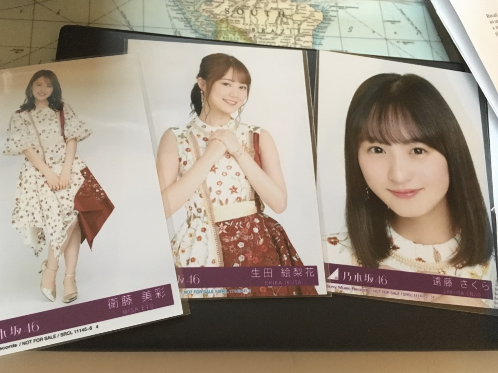

# On Randomness of  "Nama Jashin" collection (simple math)

Created: April 18, 2019 10:08 PM

Math is math and it is supposed to guide real-world decisions......but not always. There are times one would rather stick to the randomness like "what if it was me..." fantasies, even the math and probability have already given enough hints to stop. 

Generally, this blog is supposed to be a reminder using freshman-level math (calculus), because I constantly forget the lesson of math when I encounter real-world issues, as in the case of "Nama Jashin" collection. Here I provide this blog simply to 

- remind myself not to spend too much money on it.
- to make it clear to myself that how the randomness of "Nama Jashin" collection is leveraged to sale promotion, which is arguably the oldest, but most effective trick for commercial promotion sale.

More specifically, main content of this blog is as follows

- to provide an expectation estimation of *nama jashin*  collection in a basic problem setting. Answers the question of "**How many CDs I need to buy on average to get the desired distinct type *nama jashin ?***"
- to provide probabilistic bound of a instance case, in other words, to determine how lucky or how unlucky you are, given a result of your collection. Answers the question of "**How many CDs you needs to buy if you want to get the desired one *nama jashin* at a high probability, say 99%**"
- to provide also,  estimation in some more complicated settings and how to deal with new settings.   Answers the question of "**How many CDs you need to buy on average to collect multiple distinct types?**"

Outline of content

* TOC
{:toc}

## Intro and background

"*Nama Jashin*" (生写真, or なまじゃしん in *hiragana*) is a Japanese word, and could be roughly translated as "not-photoshoped raw photos", or "photos that has not been put into commercial usages before". It is commonly seen as a sale promotion scheme to put *nama jashin* into musical CDs or other commercial products. Usually, Japanese musical singers and bands will put *nama jashin*  of themselves into the limited edition of their album CDs. And if one wants to collect a full set of *nama jashin*, one simply has to buy more CDs.

A full set Nama Jashin (three types in total), of 白石麻衣 (Shiraishi Mai) from Nogizaka46. (photos from Internet)

Note that, the Japan music market is strangely special and prosperous, so is the strangely special promotion scheme. Usually, for an album or a single, there would be multiple versions of it, limited edition, normal edition, with CD, or with CD and DVD. For limited editions there might also be type A, type B... or even type C and type D. Taking an extreme case, the recently-debut musical group Yoshimoto-zaka 46, consisting of former *Owarai* talk-show comedians, has in total 46 types of their first single CD. 

Now you might wonder, what is special about the limited editions?  Well, one would expect to see 特典(*extra content*, or *special gift*) in limited editions, one of such extra content is the *nama jashin*. Generally speaking, one piece of *nama jashin* is put into the limited edition. But the simple sale promotion trick here is that, there could be multiple types of *nama jashin*, and the record company encourages you to buy multiple limited edition CDs to collect all kinds of *nama jashin* . 

I will talk about the randomness on how one is supposed to get the full set of *nama jashin*, the expectations, and the probabilistic bound. I will start with a simple setting and then move to advanced "more real-world" cases.

Let us now go into the details.

## 1. **Simple setting: How many CDs I need to buy on average to get the special one *nama jashin ?***

We start with a simplified setting of the *nama jashin* problem, suppose you want to get one special type of *nama jashin* out of `n` possibilities*.*  And you are a stubborn consumer that you will continue buying a new CD  if you have not get the special type you want. Then a natural question you might ask is,

**How many CDs I need to buy on average to get the desired *nama jashin ?***

The answer is relatively easy. We denote the probability of you getting the one and only *nama jashin* as `p` and we assume a uniform distribution of all types of *nama jashin*. 

Different CDs purchased could have different outcomes and of course the uniform distribution should not be the real case, but we will go with it because its simplicity.

To answer of question of "how many CDs do you have to buy until I get the *nama jashin* on average?", we let `X` as a random variable equal to the number of CDs you bought. For `j` >0, we have 

$$
Pr(X=j)=(1-p)^{j-1}p
$$

In order to get the one and only *nama jashin* at exactly `j` CDs, you have to fail exactly all the previous `j-1` CDs, i.e., you fail exactly `j-1` times and you succeed at the `j`-th time. Now, applying the definition we have

$$
E(X)=\sum_{j=0}^{\infty} j \cdot Pr(X=j) 
$$

$$
=\sum_{j=1}^{\infty} j(1-p)^{j-1}p = \frac{p}{1-p} \sum_{j=1}^{\infty}j(1-p)^j
$$

Now we are stuck because the sum of series looks weird and we do not know how to compute the exact value. Note that we have this prior knowledge:

$$
\sum_{i=1}^{\infty} x^i = \frac{1}{1-x},  \mathrm{\ for \  } |x|<1
$$

We take the derivative of both side, which will not change the radius of convergence of the original summation series. We get 

$$
\sum_{i=1}^{\infty}i \cdot x^{i-1} = \frac{1}{(1-x)^2},  \mathrm{\ for \  } |x|<1
$$

We then multiply a `x` to both side,

$$
\sum_{i=1}^{\infty}i \cdot x^{i} = \frac{x}{(1-x)^2},  \mathrm{\ for \  } |x|<1
$$

We substitue `x` with `1-p` , then we get

$$
\sum_{j=1}^{\infty}j(1-p)^j = \frac{1-p}{p^2}, \mathrm{\ for \  } |p|<1
$$

Now we go back to the Expectation we are interested in

$$
E(X)=\sum_{j=0}^{\infty} j \cdot Pr(X=j) =\frac{p}{1-p} \sum_{j=1}^{\infty}j(1-p)^j
$$

$$
=\frac{p}{1-p} \cdot\frac{1-p}{p^2} = \frac{1}{p}
$$

If we assume the uniform distribution is the case then the CDs you need to buy as expectation is 

$$
E(X) = \frac{1}{p} = \frac{1}{ \frac{1}{n} } =n
$$

where `n` is the total number of types.

So as expectation you will need buy exactly `n` CDs if you want to get one special type of *nama jashin* out of `n` kinds.

## 2. A probabilistic bound of success.

But this is still not very interesting, because one typically buys multiple CDs at one time instead of buying one CD at a time.

In practice,  considering the time cost of shipment or the transpotation cost to go the CD store, it is really not a good idea to constantly buy one CD at a time, open the CD and then buy a new one.  Typically, one goes to the store and purchase multiple CDs in one time.

Suppose that this is the more advanced setting, you want to get one special type of *nama jashin*, but you could only purchase multiple CDs at once. That is, you go to the store and buys enough number of CDs and you want to know a simple number:

 

**How many CDs you needs to buy if you want to get the desired *nama jashin* at a high probability, say 99%?**

We denote the number of CDs you need to buy to ensure a 99% success probability as `t`. Note that 99% of success means 1% probability of failure, we now model the probability of failure, i.e. the probability of failure if you buy `t` CDs, and we want to make this probability to be small. We get the following inequality by applying the Chernoff bound 

$$
Pr(X> (1+\epsilon)\mu ) \lt [\frac{e^{\mu}}{(1+\epsilon)^{(1+\epsilon)}}]^{\mu}
$$

by substituting `t` with `(1+\epsilon)\mu` where `\mu` is the expectation we mentioned above

$$
Pr(X>t) \lt [\frac{e^{ n }}{( \frac{t}{n})^{\frac{t}{n}}}]^{n}
$$

So since you have the above formula, it is easy to determine the exact `t` by enumerating from small numbers.

## 3. More advanced problem setting

Now let us consider a more complicated, (but more real world case), suppose you are not only interested in getting just one *nama jashin*, but rather multiple types of *nama jashin.* In other words, you want a colleciton of three, or five types out of the `n` types. The question you want to ask is:

 **How many CDs you need to buy on average to collect a subset of distinct types?**

Suppose the size of this subset is `s` which could be 4, or 5 and the total type `n` could be 100. Intuitively, to get `s` types at least you will have to buy `s` CDs at least. But this is only the best case and we wonder what is the exact expectation.

Let us say the *nama* *jashin* collection process is in phase `j` if you've already collect `j` types and you are waiting to get a new type. When you get the `j+1`-th type, phase `j` immediately finishes and phase `j+1` starts. So in this formulation, we start with `j=0` and we finish at `j=s`. 

Let `X_j` denote the random variable equal to the number of CDs you buy at phase `j` . Then

$$
X= X_0+X_1+\dots+X_{s-1}
$$

For each step, again by assuming the uniform distribution, we get the probbility of success at phase `j` is

$$
p_j = \frac{s-j}{n}
$$

And thus the expectation of phase `j` (as mentioned in the first part of this post) is

$$
E(X_j) = \frac{1}{p_j} = \frac{n}{s-j}
$$

By the linearity of expectation we get

$$
E(X) = \sum_{j=0}^{s-1} E(X_j) = \sum_{j=0}^{s-1} \frac{n}{s-j} = n \sum_{j=0}^{s-1} \frac{1}{s-j}
$$

Note that the summation could be viewed as the Harmonic function that

$$
\sum_{j=0}^{s-1} \frac{1}{s-j} = \sum_{j=1}^{s} \frac{1}{j}= H(s)
$$

where the Harmonic number is defined as

$$
H(n)=\sum_{j=1}^{n} \frac{1}{j}
$$

Now we have the final solution, note that we could easily compute Harmonic number in softwares.

$$
E(X)=nH(s)
$$

where `n` is the total number of distinct types and `s` is the number of distinct type you wish to collect. In extreme case where `n==s` the expectation becomes

$$
E(X)=nH(n)
$$

which is asymptotically equal to `O(nlogn)`.

## Concluding

I will not cover the probabilistic bound for this setting. Below attached is a piece of my experience of *nama jashin* collection. I know, real life is not expectations. What happens happens anyway. And I am a lucky man!

Anyway just to conclude, I talk about three question in this post

- “**How many CDs I need to buy on average to get the desired distinct type *nama jashin ?***”
- “**How many CDs you needs to buy if you want to get the desired one *nama jashin* at a high probability, say 99%**”
- “**How many CDs you need to buy on average to collect multiple distinct types?**”

and I admit that real-world setting might be more complicated than this. But still, methods shown here could be adopted to deal with those advanced settings.

Again, I sincerely recommend everyone to re-consider of illusional fantasy of randomness. Remember that, good luck is not for everyone.

I will not cover the probablistic bound for this setting. Below attached is a piece of my experience of *nama jashin* collection. I know, real life is not expectations. What happens happens anyway. And I am a lucky man!

Thanks for reading!

my result with a set of the 4-th album titled as "今が思い出になるまで" of Nogizaka46(乃木坂46) 

Again, thanks for reading!

I used to think I should use Chinese regarding this topic but, anyway, the language of probability somehow is more straightforward expressed in English and I should, in many occasions, practice my poor English as much as possible, as suggested by Martin, my supervisor. Thanks again for reading!
