# On Bayesian Deep Learning, an outsider's view

Created: February 6, 2020 10:59 PM

[Jialin Lu](https://luxxxlucy.github.io)

<aside>
📎 [Jialin LU](https://luxxxlucy.github.io), Feb 2020 This is presented at the group meeting of Ester's lab.

</aside>

Basically this is an outsider who does not work on Bayesian methods, but somehow was *volunteered* to do a survey and give a presentation of the pros/cons of Bayesian Deep Learning. I will not talk about the math, but only the ideas intuitively.

---

Please see the typesetted pdf if you prefer reading as a short paper.

[This is a supplementary version in PDF.](assets/handout.pdf)

This is a supplementary version in PDF.

[This is the corresponding slide for the presentation](assets/slides.pdf)

This is the corresponding slide for the presentation

<aside>
💡 A reminder: if you are not into the long blog, you can first look at the supplementary pdf listed left-side, which is self-contained and should provide the main idea.

</aside>

---

**Why I am doing this**

- I barely know deep learning, I do not work on this and I know even much less about Bayesian methods.
- But what happened is on the NeurIPS 2020, there is a tutorial called on Bayesian Deep Learning by [Emtiyaz Khan](https://emtiyaz.github.io) (RIKEN, Japan), which I actually failed to attend.
- And later, some lab members and Dear Martin seem to agree that
    
    > "wow bayesian deep learning is kind of cool"
    > 
- Then I somehow was *volunteered* to do this presentation

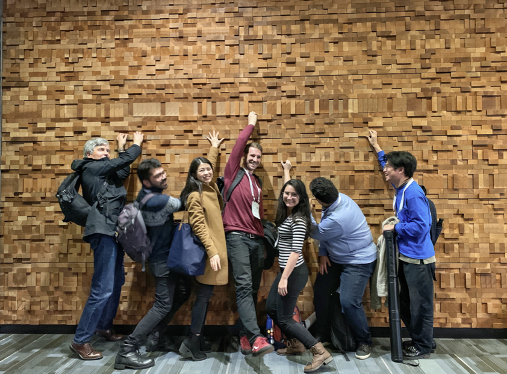

Lab mates at NeurIPS 2019 (I am the one in the rightest, wearing the volunteer shirt)

<aside>
💡 There will be no math, I will try to convey only the intuitive way for understanding.

</aside>

But anyway I read some papers and organize a short survey into this topic of **Bayesian Deep Learning**. The outline of this post can be summarized as follows

- First I give the motivations of combing Bayesian methods with deep learning.
- Then in Part 2 I introduce the main theme of approximating the posterior distribution of NN’s parameter and talk about two technical approaches for tackling it.
    
    namely, the variational-based approximation and the interpolation-based approximation (I use this term to refer to Stochastic Weight Average and related methods)
    
- In Part 3 I show, by referring a simple experiment, that the BDL thing is a little bit frustrating in practice and does not really work yet.
    
    Specfically, I refer to Deep Ensemble as a simple baseline, and discuss why it works. 
    
    I will also suggest that why, for fair comparison, we should use multi-mode variational inference (such as a mixture of Gaussians) and multi-trajectory Interpolation. This is because the true posterior of DNN is too complicated and it certainly has multiple modes (high-performing local minima as lottery tickets).
    
- I will then end with some more personal opinions
    
    There are mainly two advice, or the possible direction of research we can do. 
    
    - One is that, from a basic research perspective, we should start consider model comparison with alternative architectures, not only on the weights anymore.
    - Another is, for practical merits, to consider the purpose of Bayesian Deep Learning beyond the standard setting (of supervised regression). We should care more specific usage of DNN, such as transfer learning, meta-learning. I will explain why the uncertainty from posterior plays an important role in these tasks and briefly about how to do it.

## Introduction

## Part 1: Bayesian Deep Learning, but why?

### Motivations for combining Bayesian learning and deep learning

**Bayesian Learning is great, deep learning is also great.** 

- Bayesian Learning is such a flexibleframework, we can use to modelmany things, even the most flexiblehuman learning. There are bulks of works on computational modelling of cognition and psychology are now Bayesian, one example is the PhD thesis of [Tenenbaum,1999].
- Deep Learning is also a very general and flexible framework (of course, flexible in a different way). It can process large and complex data, and more importantly the design of architecture is flexible. This flexible customization of achitectures makes especially applicable in various applications.

**These two methods is complementary.**

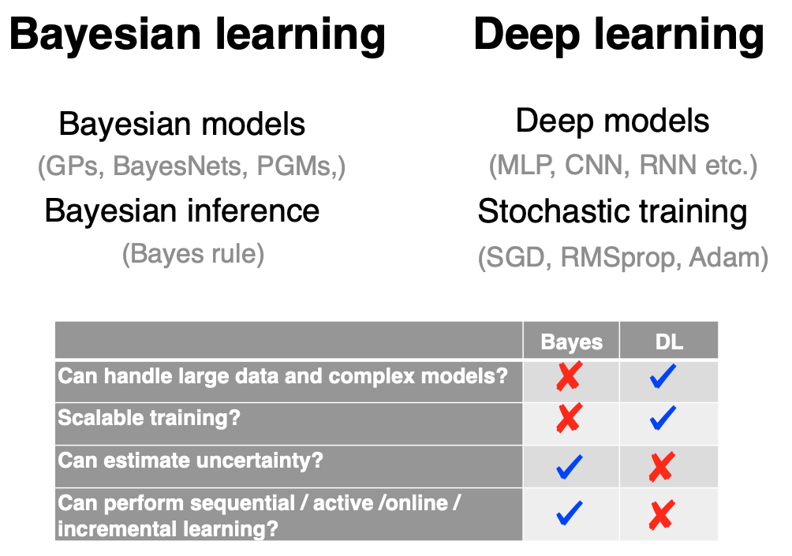

image source, Emtiyaz Khan 2019

As shown in the above figure, Bayesian learning handles the uncertainty as the key priority of modeling and can flexibly consider adaptive learning; the only problem is that it is not so efficient. Applying to large datasets is generally infeasible, as the computational cost is quite high.

Deep Learning, on the contrary, results in a fully deterministic model (in terms of the weights of the model). It scales well on very large datasets and easily handles various types of data.

Combining these two methods to get the best of both worlds, and to eliminate the disadvantages of each other is really a natural thing we’d like to expect. Can we combine DL and BL so that we can get

- able to handle large data and complex models
- able to scale in very large datasets
- able to estimate model uncertainty
- able to perform sequential/active/online/incremental learning

Can we get all these four points?

<aside>
💡 But I guess the problem is not really about "*to be or not to be*", but rather a more technical question of "*How to*"

</aside>

The problem is really about how to combine these two methods. There are mainly two general ways on how to combine BL and DL

### But "how to"? Two ways of combining

Here I  summarize two ways on "how to" combine DL and BL, which are DL→BL and BL→DL respectively.

- **DL→BL**: make a hybrid model by replace a component with a Deep Neural Network
    
    This means we apply a deep neural network to Bayesian learning. Basically, when you have a probabilistic graphical model, and sometimes you can model a directed edge of this graphical model using a deep neural network. 
    
    - An example would be the Variational Autoencoder
        
        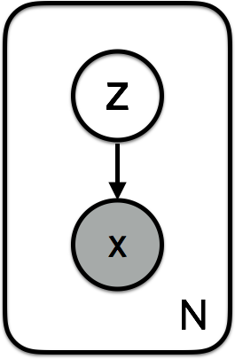
        
        We simple model one directed edge using a DNN. If we do not use a DNN to model this edge function, then this is a very standard and simple generative model. It is just that this function is constrained by its capacity. Using a DNN to model this edge functional, will enable to learn very complex non-linear transformations. This would be particularly useful in some real-world domains where simple transformations do not work so well, like natural images.
        
    
    Of course, variational autoencoder is to simple a case. We can make it to more complicated models, such as topic modeling, recommendation systems. 
    
    The merit of DNN is not only about the ability to learn non-linear transformations, but also being able to handle a lot of sources of information, image, transaction, natural languages, all information that is utilizable can be utilized.
    
- **BL→DL**: Bayesian Treatment of Neural Networks
    
    This means we want to make the parameters of a DNN, not just a fixed value anymore, but to have a distribution of possible values. I call it “Bayesian Treatment of Neural Networks”. When people say, *Bayesian Deep Learning* or *Bayesian Neural Networks*, it is referring to the same thing. 
    
    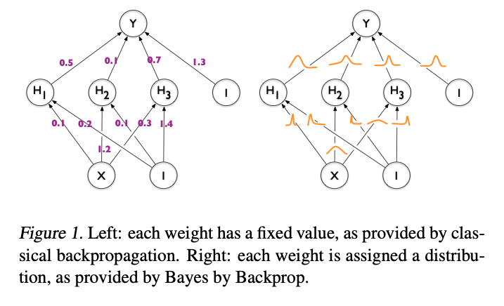
    
    Image source from <Weight Uncertainty on Neural Networks>
    
    Basically this is a Bayesian view of a deep neural network, in a sense that is similar to the textbook when talk about the Bayesian view of linear regression. We make not just a hard assignment of value for the weight of a DNN, but a posterior distribution on the values of the parameters.
    
    Of course, the current neural networks is really different from linear regression, because we have many many parameters! We call it overparameterization because the number of parameters can be much larger than the data points! This is exactly the reason that analysis and improvement of Bayesian Deep Learning are very hard.
    
    One recent work [Weight Uncertainty in Neural Networks](https://arxiv.org/abs/1505.05424). But in fact the idea is not really new, in 90s we already see a lot of interesting work and have set the seminal foundation of research in this direction. But I guess one important things is that, the current way we train DNN is a little bit strange for a lot of standard theory to make sense. This is mainly because, the neural networks we are currently using is very often an over-parameterized one, that is, we have a neural network of extremely massive number of parameters. too many parameters even more than the number of data points.
    
    This is kind of a ill situation and leads to a natural result that for limited dataset, there can be multiple models that can t fit the data as well as the prior well.
    
    Note that this does not mean the Bayesian Neural Network is not useful anymore. In fact, this is exactly the case where we need Bayesian! It is just that we need to be wisely Bayesian, in a modern way that suits the modern over-parameterization nature of current neural networks. 
    

In this post, I will not talk about the DL→BL direction but only talk about BL→DL. Just to clarify the terminology, I will also use  the term "Bayesian Treatment of Neural Networks" to emphasize that we are talking about "BL→DL". People also uses Bayesian Deep Learning, or Bayesian Neural Networks. You just need to know that these are the same thing, just alias names.

## Part 2: Bayesian Treatment of Neural Networks

The Bayesian Treatment of Neural Networks means that we are after one single resultant model, but a distribution of all possible models, the posterior. It is better to think that we have a set of possible resulted models, and each is also weighted by some "fitness" value. Bayesian inference implicit performs model comparison and selection in this posterior.

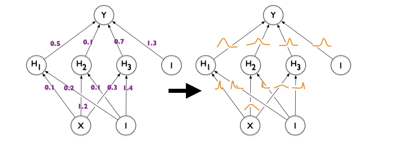

Well it is called Bayesian because the posterior is computed by the Bayes rule.

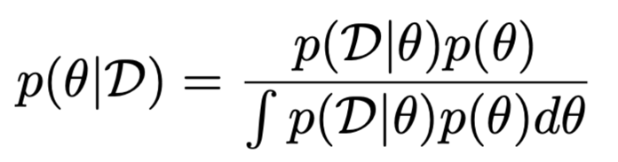

The posterior is of desire because there are a lot of things we can do with it. We can use to do model selection, we can marginalize to to Bayesian Model Averaging to do prediction, we also enables to do prediction with uncertainty. This is really an important and principled way to do a lot of things, but the vital question, again, is not to obtain or not to obtain it, but rather how to obtain it.

<aside>
💡 I will repeat, the goal is to obtain a good approximate of the posterior distribution.

</aside>

Now I introduce two categories of approaches that approximates the posterior, namely the variational-inference-based approximation and interpolation-based approximation.

Note that the the name of the latter approach is my own invention and may not be consistent with the literature. But I found it intuitively summarizes the key aspect of this track of approaches. We will talk about this anyway later.

### Option 1: Variational Inference-based Approximation

The variational-inference-based approach will first require you to predefine the form of a distribution **q**, and then, you adjust the parameters of **q** to fit the true posterior. 

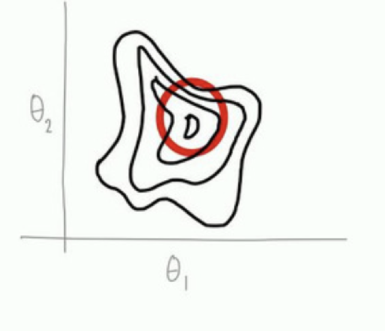

suppose the circle (a Gaussian)  is **q** , you can adjust the mean and variance to fit the true posterior

The trick of variational inference is not uncommon, basically you can define a distance between the true posterior and the **q** which you can optimize. Usually this is done by doing some math manipulations and you can get one thing called ELBO (the evidence lower bound) and then you just optimize this ELBO to get the things you want.

One thing for using variational-inference-based approximation is because it is kind of universal and general.

Remember the textbook example, when we start to view linear regression in a Bayesian view, and if we set the distribution of error to be a Gaussian, then we find that in the end it turns out that we are optimizing the least square error.

I guess this is the same thing going on here. As in the NeurIPS tutorial from Khan.

He first introduced the following general learning rule, the Bayes learning rule

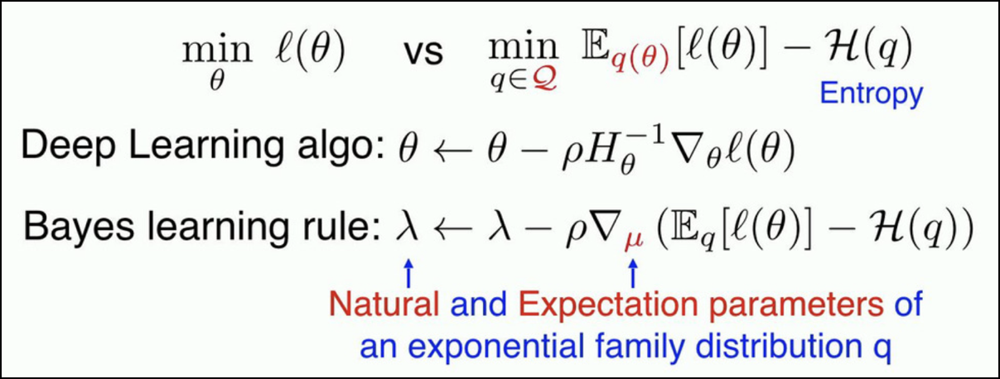

And then by filling the holes by the right assumptions, you find out that it is just some standard learning optimizers like SGD.

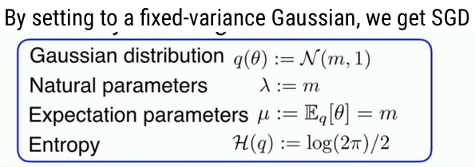

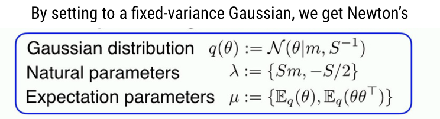

There are also more sophisticated cases! By play the assumptions right, you can also get optimizers like RMSprop and Adam.

Of course, it also means you can run further, you can derive more complicated algorithms, for example, by assuming the posterior to be not just a gaussian, but a mixture of gaussian.

However, the problem of variational-inference based approximation is that it is very computational costy. In fact, some methods only do this variational inference for the last layer. This is really an important and practical issue.

In the paper called <Practical Deep Learning with Bayesian Principles>, it finally makes to be practical.

**But really, how good is it?**

as a representative work of variational inference based method, <Practical Deep Learning with Bayesian Principles>, a NeurIPS 2019 paper, it says:

- [Practical Deep Learning with Bayesian Principles](https://arxiv.org/abs/1906.02506)

> By applying techniques such as batch normalisation, data augmentation, and distributed training, we achieve similar performance in about the same number of epochs as the Adam optimiser, even on large datasets such as ImageNet.
> 

The author says it only takes twice to three times of the time compared with Adam, from what I understand, I think this is very impressive.

But you can see the tricky situation here, remember the reason we start to be Bayesian, we want this posterior to give us better accuracy, better generalization, better uncertainty measure. But after you paid so much efforts, derived such a general framework and spent so much time into the techniques for the practical implementation, and in the end, this "similar performance to Adam" is what you get.

Seriously. It is not okay.

### Option 2: Interpolation-based Approximation

The above mentioned variational inference-based approximation may seems too complicated to be useful, consider all the math and implementational efforts paid to make it work. But the interpolation-based method described below, might seem like the contrary, it seems too simple to be useful (but in fact it works)

Also there are many works categorized in this name, which I list below

- [A blog explaing](https://pytorch.org/blog/stochastic-weight-averaging-in-pytorch/)
- [**Loss Surfaces, Mode Connectivity, and Fast Ensembling of DNNs**](https://arxiv.org/abs/1802.10026)
- [**Averaging Weights Leads to Wider Optima and Better Generalization**](https://arxiv.org/abs/1803.05407)
- **A Simple Baseline for Bayesian Uncertainty in Deep Learning** (SWAG)
- More specifically, construct a low-dimensional space, basically, using some kind of dim-reduction methods, PCA etc. and then you can interpolate in this low-dimensional space.
    
    [**Subspace Inference for Bayesian Deep Learning**](https://arxiv.org/abs/1907.07504)
    

But I would like to start simply, just when we run the standard optimizer, such as Adam, interpolation-based approximation only requires to select and keep record of some points that are visited during the trajectory of the optimization. And then after you're done, you use some of collected point to do interpolation to approximate the posterior. ( In extreme case, suppose you only want the mean of the posterior, then simply do weighted average, even unweighted average)

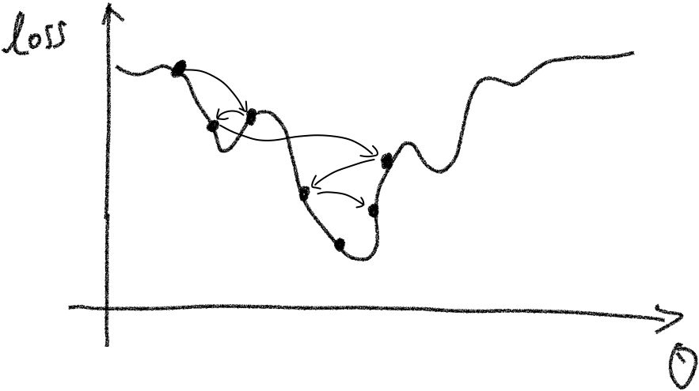

This is in fact, quite straight forward, collecting some points during the optimization trajectory does not require extra computation, there is only some requirement of space to store these points.

Of course, how to collect the points and how to interpolate are still an unexplored space of investigation. Any heuristics that makes sense and happen to work well can be applied here. For curiosity, I would recommend you to look into the above mentioned papers on interpolation-based methods. I assure you that even seems to be complicated and full of math,  these methods are essentially very simple and intuitive to follow.

**How good is it?** From what I understand, it should be slightly better than Adam. So yes, it should be much better than variational inference based approximations. Not to mention that it does not require extra computation (unlike variational inference based)

## Part 3: What goes wrong? A simple baseline and a simple experiment

One thing that I want to remind readers is that, we start using bayesian neural network, because of the promises. It says, or people claimed that it will improve the accuracy, give calibrated uncertainty, robustness and generalization, etc. But in practice, it is hard to achieve such promises.

### A simple baseline

In fact, there is a very simple baseline, to use an ensemble of neural networks. We initialize many different models with different random initialization, and train them independently. 

see [**Simple and scalable predictive uncertainty estimation using deep ensembles.**](https://arxiv.org/abs/1612.01474)

At the end we can get many models, we say these set of models can approximate the  true posterior. For example, we can average the prediction by these many models and say it is a approximation of the Bayesian Model average.

### A simple experiment

It is shown that this simple baseline of making an ensemble, is actually better in terms of both accuracy and uncertainty.

I refer to a experiment from

[**Can You Trust Your Model’s Uncertainty? Evaluating Predictive Uncertainty Under Dataset Shift**](https://arxiv.org/abs/1906.02530), NeurIPS 2019

It benchmarks a lot of Bayesian Deep Learning methods see  [Bayesian Deep Learning Benchmarks](https://github.com/OATML/bdl-benchmarks).

Basically in the paper it uses a experiment setting of gradually shifting the distribution of data. This enables to see the gradual trend of degradation of different methods.

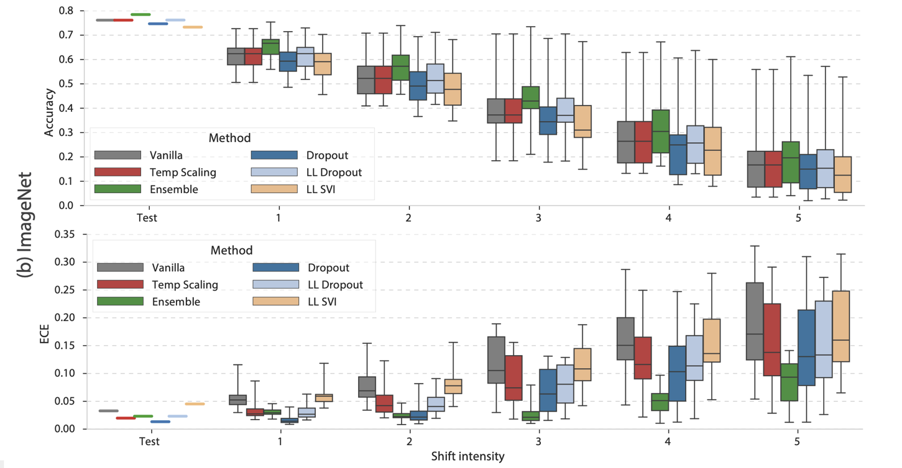

for left to right is the shift of data. The top figure is accuracy (the higher the better) the bottom figure is the metric for uncertainty (the lower the better)

You can see that Deep Ensemble is really good in both accuracy and uncertainty, but wait...

### A simple explanation

Why this simple baseline of ensemble is so good? What is missing? I will now give a simple explanation.

The reason is that, the DNN is different from simple linear regression, it is different because it is overparameterized and is so complicated. According the lottery ticket hypothesis, there could be many many high-performing local minima you can find in a network. With different random  initialization you can result in a diverse set of high-performing local minima.

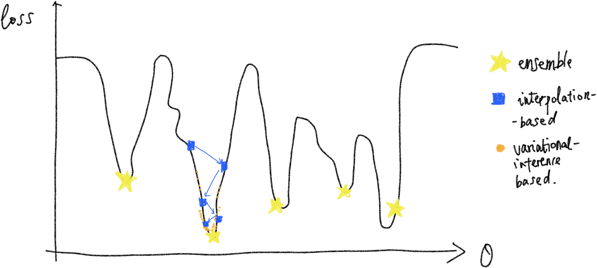

Let me introduce this figure to show what goes wrong. 

- The ensemble methods, with different random initialization, may be able to result in a collection of different high-performing local minima. some also call it different **Basin of attraction**.
- However, the interpolation based method, only explore one trajectory, so it is likely that it only explores one particular local minima
- The variational-inference based is more or less the same going on here. It focuses its mean to be in a local minima and spreads as variance. But still, it is still exploring just one local minima.

Now you can see why comparing ensemble is really not fair. To be fair, what we need this

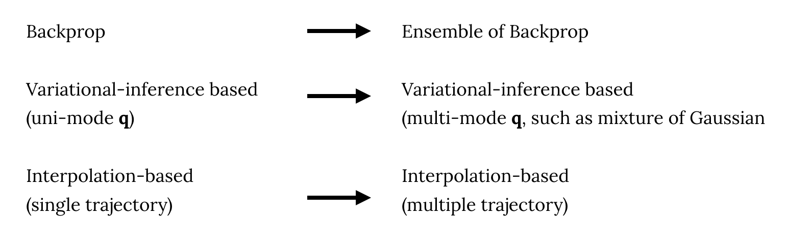

In order to compare with ensemble:

- For the variational inference-based method, we need to use a multi-mode distribution as **q**. For example, we should use a mixture of gaussians.
    
    Uni-modal → multi-modal?
    
    **Fast and Simple Natural-Gradient Variational Inference with Mixture of Exponential-family Approximations.** ICML 2019
    
    Basically, you consider the posterior to be a mixture of, for example, Gaussians.
    
- For the interpolation-based method, you should consider use multiple trajectories of optimization and the interpolate.
    
    A simple way to do it called multi-SWAG is shown in this recent paper [**Bayesian Deep Learning and a Probabilistic Perspective of Generalization**](https://arxiv.org/abs/2002.08791)
    

## Part 4: A New Hope

### Advice 1: Structure, not weights

Right now the estimate of posterior is focused on the weights of a neural network, but in fact we know

- Architecture is also an essential part we want to do model comparison, which should also be considered in the posterior
- Architecture is also where we have better intuitive understanding, that means put priors in the space of architecture should be more human-comprehensible, and more easily.

And this is not new either, MacKay proposes to do so in the 90s. But the problem is again the overparameterization, how can we possibly eunmerate all possible architectures in this world?

Sure, so heuristic can be employed. Let us wait and see what will happen.

### Advice 2: Think of the purpose and more specific use of the posterior

Advice 1 might be too hard and too fundamental a question to ask, let us know consider a more practical one. The logic is quite simple, in practice, we are not actually interested in $$P(\theta \vert D)$$ itself, but rather the things we can do with the posterior. 

I believe this should have some impact on more specific usage of neural networks, such as transfer or meta-learning, which are the exact case where we need posterior of parameters.

Suppose we have a posterior, and we might be able to determine when it can transfer useful information, and when it transfers non-sense. There are really many technical possiblities  we can do with a posterior (approximated using ensemble). In fact, there is an interesting paper on how we can use uncertainty to detect at test time, whether the test input is out-of-distribution.

[**Detecting Extrapolation with Local Ensembles](https://arxiv.org/abs/1910.09573)** ICLR 2020

Note that It makes a post-hoc ensemble to approximate the posterior.

## To Conclude

So to conclude, I give a short survey of the so-called Bayesian Deep Learning. In **PART 1**:  I give the motivation of Bayesian Deep Learning. **PART 2**:  for the goal of obtaining a posterior distribution of models, not just a single model, I introduce two technical approach namely variational-inference based, and interpolation-based approximations. In **PART 3**: I talk about ensemble as simple baseline, and discuss why ensemble works so well by visiting a diverse set of high-performing local minima. In **PART 4** I give two personal advice. The first is to also consider the possible architectures, not just the weight, and the second is to consider the potential benefits of posterior, not just in standard setting, but for transfer or meta learning.

## Recommended Further Reading

I list some interesting materials for reading. Note that these are not technical papers. 

- [**The case for bayesian deep learning**](https://arxiv.org/abs/2001.10995), Andrew Wilson 2020
- [**Bayesian Deep Learning and a Probabilistic Perspective of Generalization**](https://arxiv.org/abs/2002.08791v1) Andrew Wilson 2020, [code is here](https://github.com/izmailovpavel/understandingbdl).
- [Bayesian Neural Networks Need Not Concentrate](https://jacobbuckman.com/2020-01-22-bayesian-neural-networks-need-not-concentrate/)

<aside>
💡 I will also recommend  to read the supplementary pdf of this post, which is listed at the beginning of this post.

</aside>
