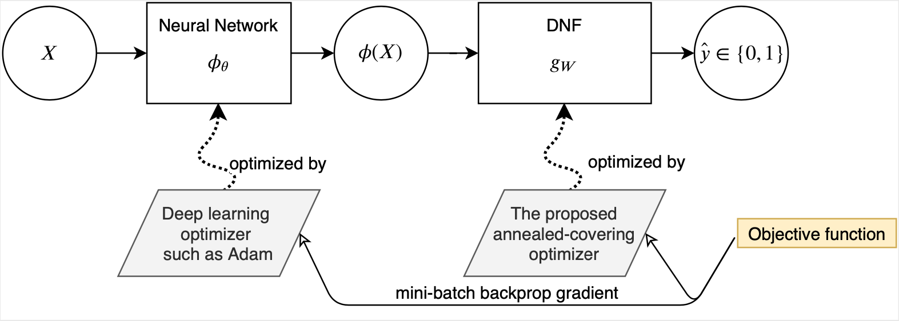

# Neural Disjunctive Normal Form (in dev)

The thesis version of this project can be found here.

[neural_dnf.pdf](assets/neural-dnf-thesis.pdf)

**Neural Disjunctive Normal Form:**  Interpretable classification by Vertical Neuro-symbolic Integration.

**Neural Disjunctive Normal Form** (Neural DNF) consists of two modules where the first module is a deep neural network that takes raw data as inputs and produce discrete symbols, and a logical module (formulated as a disjunctive normal form) takes the symbols as input predicates and produces the final prediction. It is interpretable as the discrete symbols and the logical DNF module is interpretable.

In a recent survey (*Garcez et al, ‎2019*), this is categorized as Vertical Neuro-symbolic Integration.

## Merits

Integrating symbolic methods and deep learning is the main theme here.  Integrating symbolic AI methods gives two merits:

- Interpretability.
    
    This is more like a recent issue since the re-emergence of DNN which are all blackboxes. No one knows the mechanisms on how certain decisions are made. 
    
- Easy for human interactions to debug the model (as a result of being interpretable) for human-in-the-loop iterative learning.
    
    I believed this is a good way not only to build pratically good models aligned with human, but also to confront the important [symbolic grounding problem](https://arxiv.org/html/cs/9906002)
    

In fact, I am not the only one working on this interpretability-by-neuro-symbolic-integration approach, I have saw many works working on this direction. But I am afraid that the literature has so huge a volume of works that I cannot discuss them completely here.

## The Technical Challenge

But the main problem is learning, we wish to develop a effective optimization algorithm that

- Optimize the neural network and logical DNF module together
    
    The logical DNF module uses discrete parameters, how can we optimize it?
    
- With minimal change to the backpropagation framework for training neural nets
    
    So that it will be general and easy to use, and easy to customize.
    
- Effectively learns a  high-performance classifier.
    
    So that the resulted interpretable model is accurate and useful, while being interpretable.
    

We come up with a two-optimizer approach for optimizing the Neural DNF. We will use Adam to optimize the neural network, as it is proven to be efficient and useful, and propose a new optimizer that optimizes **discrete parameters** of the DNF.
